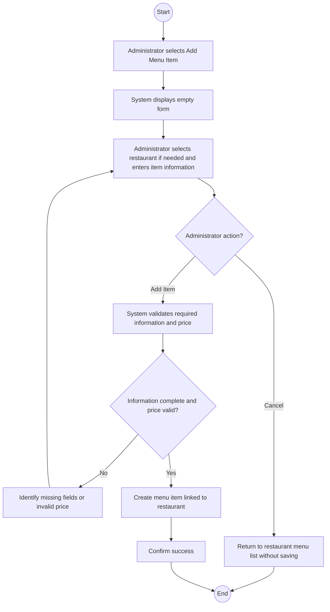
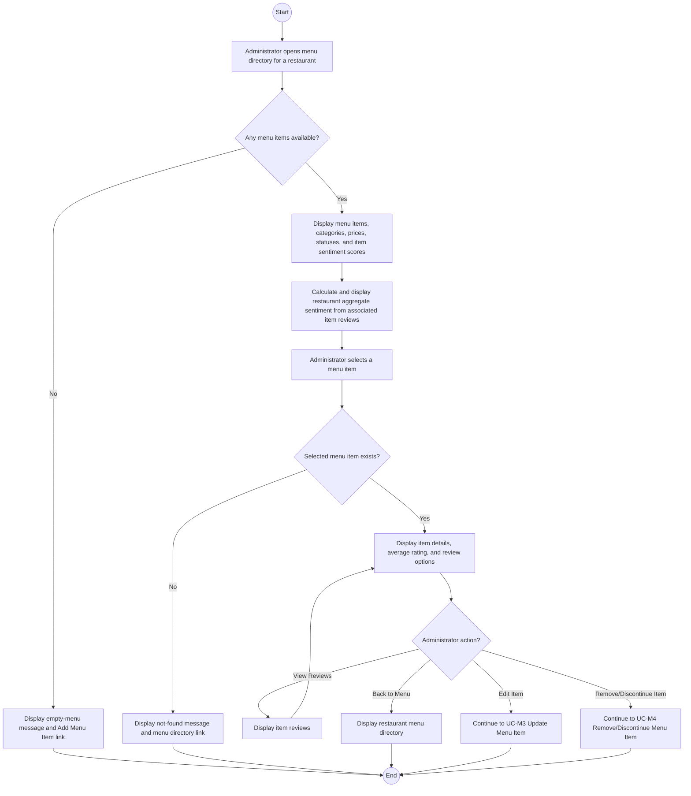
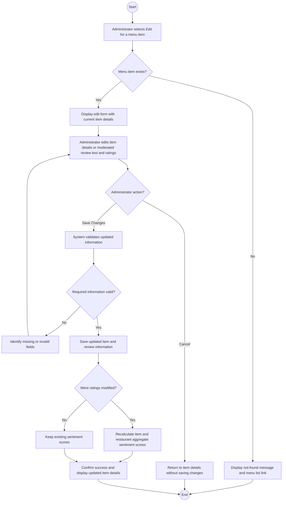
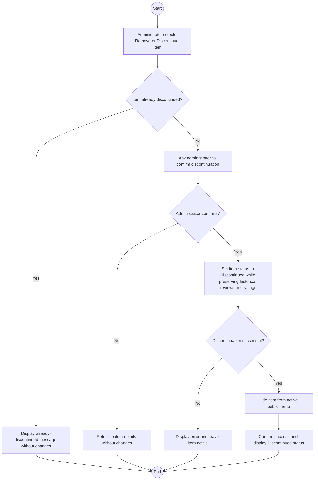

# Restaurant Menu Management Activity Diagrams

These diagrams describe the intended application behavior.
The midterm prototype does not save data.

## UC-M1 Create Menu Item

## UC-M2 View Menu Items and Aggregate Sentiment

## UC-M3 Update Menu Item

## UC-M4 Remove/Discontinue Menu Item

