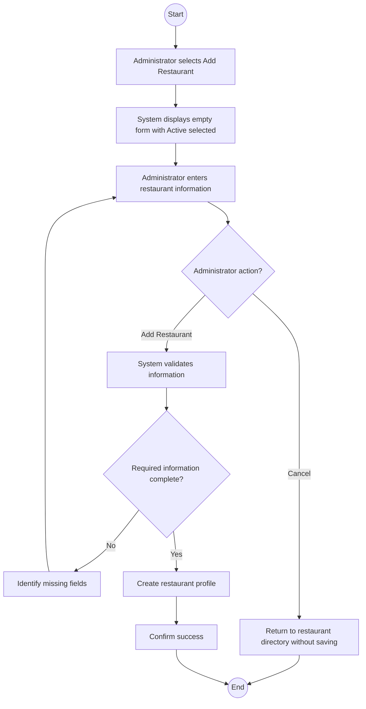
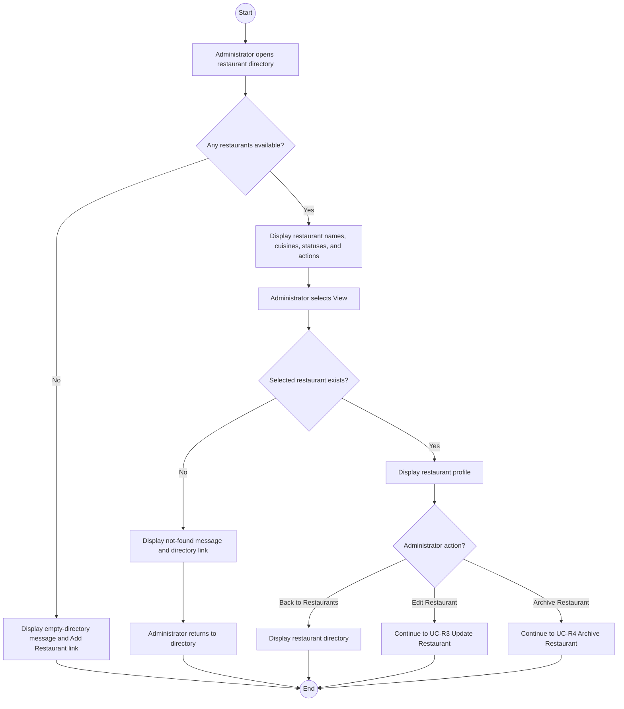
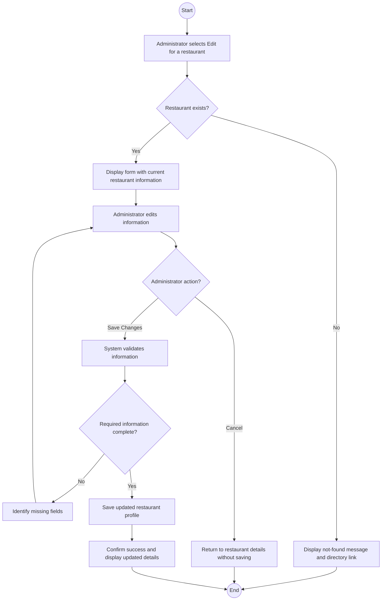
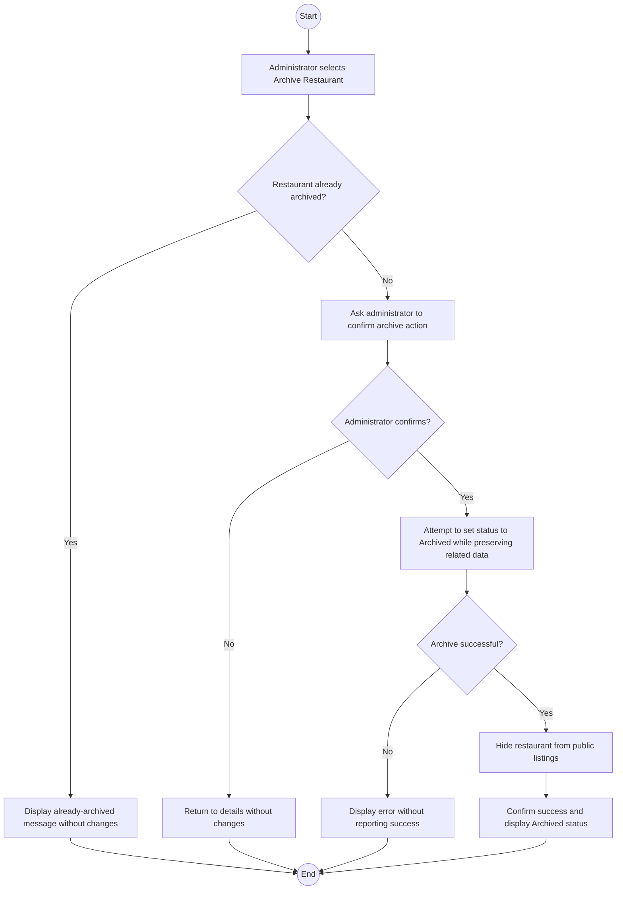

# Restaurant Management Activity Diagrams

These diagrams describe the intended application behavior.
The midterm prototype does not save data.

## UC-R1 Create Restaurant

## UC-R2 View Restaurants and Restaurant Details

## UC-R3 Update Restaurant

## UC-R4 Archive Restaurant

